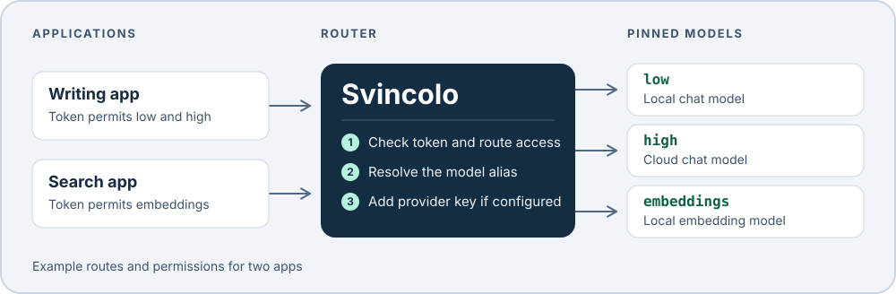

# Svincolo

**One endpoint for your apps. You choose which models they can use.**

Svincolo is a self-hosted LLM router written in Rust. Give each app its own
token and control which routes it can discover and use. An app can keep
asking for `low` while you change the model behind that alias. Provider
credentials stay in Svincolo.



For example, you can offer a writing app local chat under `low` and cloud chat
under `high`, while a search app gets only a local `embeddings` route. Names
like `low`, `middle`, and `high` are yours to define. Each pins one upstream
and model ID. If an app switches tiers through a single API, give those routes
the same API surface. [Configure model tiers and discovery](docs/configuration.md#model-tiers-and-discovery).

- **Native API forwarding.** Use Chat Completions, Responses, embeddings, audio
  transcriptions, and Anthropic Messages. Raw routes send the pinned model ID
  upstream and return provider-native responses. Streaming chat, Responses,
  and Messages can pass through as streams.
- **Validated structured output.** Managed Chat supports one non-streaming
  answer without tools on Anthropic, OpenAI, and Ollama. Structured answers
  are checked against the caller's original schema.
- **Bounded transport.** Configure caller and upstream limits, opt-in queues,
  and graceful drain. Reload routes and credential files as one snapshot.

## Try it locally

With Rust installed through rustup and Ollama running locally, save the
following as `svincolo.toml`. Set `upstream_model` to a chat model already
installed on your Ollama server.

```toml
version = 1

[server]
listen = "127.0.0.1:8080"
local_only = true
discover_by_default = false

[[upstream]]
name = "local-models"
kind = "ollama"
base_url = "http://127.0.0.1:11434/v1"

[[route]]
name = "low"
upstream = "local-models"
upstream_model = "llama3.2:3b"
locality = "local"
surfaces = { chat = "raw" }
discover = true
```

```sh
cargo run --locked -- serve --config svincolo.toml
```

In a second terminal, discover the alias and send a request.

```sh
curl -fsS http://127.0.0.1:8080/v1/models
curl -fsS http://127.0.0.1:8080/v1/chat/completions \
  -H 'Content-Type: application/json' \
  -d '{"model":"low","messages":[{"role":"user","content":"Say hello."}]}'
```

`/v1/models` should list `low`, and the chat request should return a reply
from your local model.

## Connect an application

| Client | SDK base URL | Discovery |
| --- | --- | --- |
| OpenAI-style | `http://127.0.0.1:8080/v1` | `GET /v1/models` |
| Anthropic Messages | `http://127.0.0.1:8080/anthropic` | `GET /anthropic/v1/models` |

Give each application a `[[caller]]` entry with its own `key_file` and a list
of permitted `routes`. The token goes in `Authorization: Bearer` or
`x-api-key`. Keep upstream credentials in the upstream's `key_file` or
`key_env`. The catalog reads configured routes and filters by caller, API
surface, visibility, and locality.

Clients that record consent for a destination can send the catalog entry's
`route_revision` as `x-svincolo-expect-route-revision`. A stale revision
returns HTTP 409 before a provider is contacted.

## Operate and contribute

The listener serves HTTP and can connect to HTTPS upstreams using HTTP/1.1
or HTTP/2. Keep it on loopback or an internal network. Use caller tokens and
network policy for shared deployments. The route's `locality` is an operator
declaration. Use network policy to enforce an egress boundary.

See the [configuration and operations guide](docs/configuration.md) for
provider examples, managed output, limits, key rotation, and TLS. The
[Kubernetes canary guide](deploy/k8s/README.md) shows an isolated deployment.

Run the mock-provider suite with `cargo test --locked` to check routing,
caller-scoped discovery, native Messages forwarding, and transport behavior.
Native Linux CI also checks both image targets and runs the transport load test.

[Contributing](CONTRIBUTING.md) · [Security](SECURITY.md) · [Apache 2.0 license](LICENSE)
